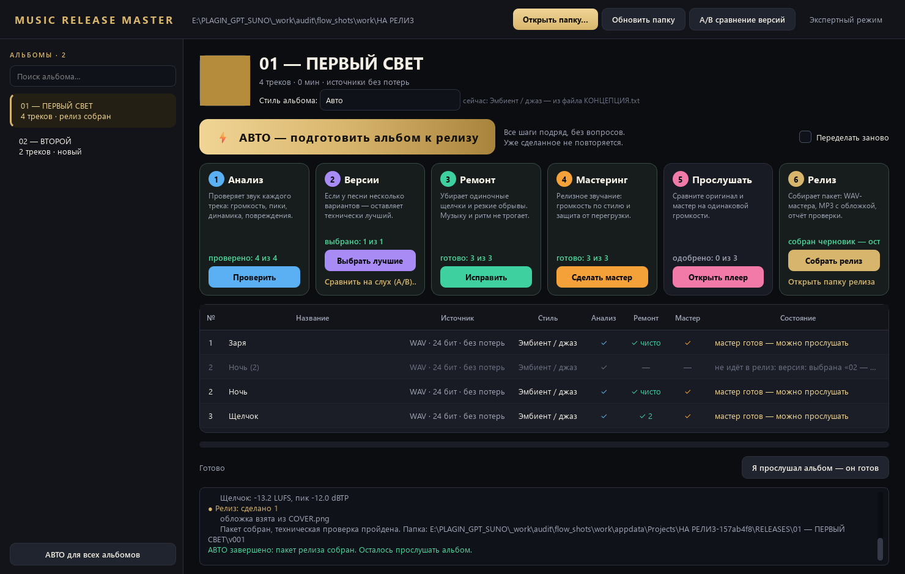
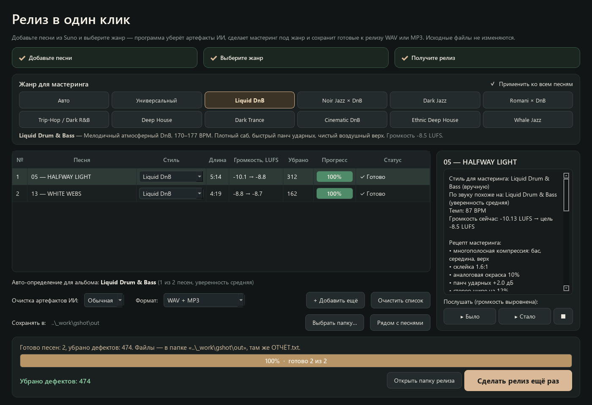
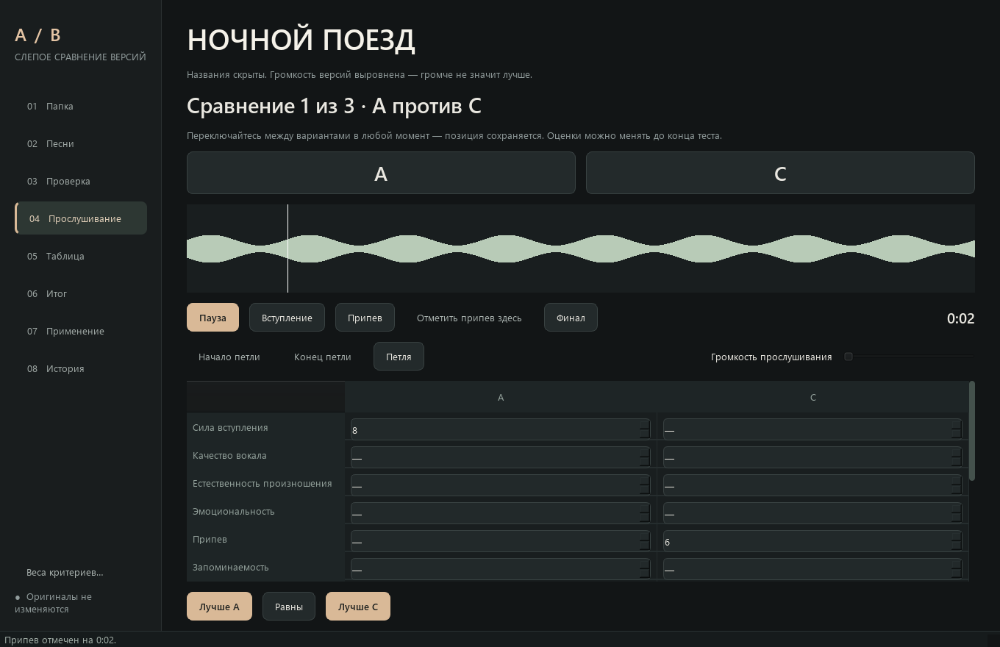

# Music Release Master

**Локальная студия для подготовки сгенерированной музыки к релизу.** Приложение для Windows, которое собирает
альбомы из папок, измеряет звук, делает бережный мастеринг, даёт сравнить результат с оригиналом на
слух и выгружает проверяемый пакет файлов для дистрибьютора.

Всё работает на вашем компьютере: без аккаунтов, подписок, платных API, облака и нейросетевых весов.
Управлять можно из окна программы, из командной строки или из ChatGPT через необязательный MCP-сервер.

*A local, offline Windows app that turns a folder of Suno tracks into a verified release package:
album library, loudness and true-peak analysis, conservative mastering, loudness-matched A/B
listening, cover art and export with byte-level validation. Interface language: Russian.*



## Что умеет

| Раздел | Возможности |
|---|---|
| **Библиотека** | Рекурсивный импорт папок, альбом = папка, номера треков из имён, сопоставление текстов и промптов, поиск дублей. Исходные файлы только читаются и защищены SHA-256. |
| **Анализ** | Громкость по BS.1770-4 (integrated, short-term, LRA), true peak с передискретизацией, динамика, стерео, спектр, темп, кандидаты дефектов (щелчки, клиппинг, провалы, обрезанные концовки). |
| **Мастеринг** | Конверсия в PCM WAV (побитово точная для lossless), цепочка `dc_hpf → eq → compressor → stereo → gain → limiter` с ограниченными параметрами, true-peak лимитер с повторным замером. Пресеты по стилям, без обязательных «−14 LUFS». |
| **Ремонт** | Локальная интерполяция щелчков и коротких клиппированных участков, фейды. Каждая правка проходит объективные проверки и требует подтверждения. |
| **Прослушивание** | Фрагменты оригинала, обработки и MP3, выровненные по громкости. Версия попадает в релиз только после явного «я прослушал». |
| **Обложка** | Импорт своей картинки с приведением к 3000 × 3000 JPEG, локальные абстрактные варианты по описанию альбома, история выбора. Встраивается в MP3 без пересжатия звука. |
| **Релиз** | Пакет `WAV_MASTER / MP3_PREVIEW / FLAC_ARCHIVE / ARTWORK / QA`, метаданные CSV и JSON, манифест обработки, чек-листы прав и раскрытия ИИ. Независимый валидатор проверяет готовые байты. |
| **Релиз в один клик** | Отдельное окно `srm-release`: 10 жанровых рецептов мастеринга (кнопкой или авто), очистка артефактов ИИ (резкость, шипящие, металлические резонансы, шум в стерео, щелчки) с живым счётчиком убранных дефектов, выход WAV 24 бит / MP3 320 / оба, выбор папки сохранения, прогресс в % у каждой песни. |
| **Сравнение версий** | Слепой выбор лучшей из нескольких версий одной песни: A/B, A/B/C и далее по числу файлов, мгновенное переключение в той же позиции, выравнивание громкости, рейтинг по 12 критериям, отчёт и безопасное применение результата. |
| **ChatGPT (MCP)** | 21 инструмент поверх того же движка: анализ, предложения, превью, одобрение по кодовой фразе, экспорт. Сервер слушает только `127.0.0.1`, доступ по токену. |

## Релиз в один клик

Окно `python -m srm.auto.gui` (команда `srm-release`) для самого частого случая: добавить песни из Suno,
нажать кнопку жанра и получить готовые к релизу файлы.

* **10 жанров автора** — Liquid DnB, Noir Jazz × DnB, Dark Jazz, Romani × DnB, Trip-Hop / Dark R&B,
  Deep House, Dark Trance, Cinematic DnB, Ethnic Deep House, Whale Jazz (всегда последний) — плюс «Авто»
  и «Универсальный». У каждого своя громкость, многополосная компрессия, окраска, панч, ширина стерео.
  Рецепты — цели, а не жёсткие настройки: песня двигается к ним ровно настолько, насколько нужно.
* **Очистка артефактов ИИ** со счётчиком «Убрано дефектов», который растёт прямо во время обработки.
* **Выход** WAV 44,1 кГц / 24 бит, MP3 320 кбит/с или оба; папка `РЕЛИЗ` рядом с песнями или любая своя.
  Файлы не перезаписываются, рядом пишется `ОТЧЁТ.txt`.

Руководство с картинками: [docs/RELEASE_ONE_CLICK_GUIDE_RU.pdf](docs/RELEASE_ONE_CLICK_GUIDE_RU.pdf).



## Сравнение версий

Отдельная программа `srm-versus.exe` (и кнопка «Сравнение версий» в основной) для случая, когда у
одной песни несколько вариантов. Версии прячутся за буквами, громкость выравнивается, вы сравниваете
их попарно и ставите оценки — программа считает рейтинг, называет победителя с уровнем уверенности
и объясняет выбор. Файлы перемещаются только после «ПРИМЕНИТЬ РЕЗУЛЬТАТ» и никогда не удаляются.
Подробности — в [docs/VERSUS_GUIDE_RU.md](docs/VERSUS_GUIDE_RU.md).



## Установка

1. Скачайте архив сборки со страницы [Releases](../../releases) и распакуйте в любую папку.
2. Установите FFmpeg (в сборку он не входит): `winget install Gyan.FFmpeg`
   либо укажите пути в переменных `SRM_FFMPEG` и `SRM_FFPROBE`.
3. Запустите `srm-gui\srm-gui.exe` (студия) или `srm-versus\srm-versus.exe` (сравнение версий).

Сборка — Windows 11 x64, без установщика и цифровой подписи; на Windows 10 не проверялась.

## Как пользоваться

1. **Откройте папку.** Папка со всеми альбомами — слева появятся все альбомы. Папка одного альбома —
   откроется он один. Папки, начинающиеся с `_`, пропускаются.
2. **Нажмите «АВТО»** — программа сама пройдёт все шаги для выбранного альбома и соберёт пакет релиза.
   Либо запускайте шаги по одному, у каждого своя кнопка:

| Шаг | Что делает |
|---|---|
| 1. Анализ | Проверяет звук каждого трека: громкость, пики, динамика, повреждения |
| 2. Версии | Если у песни несколько вариантов (`Песня`, `Песня (2)`), оставляет технически лучший; остальные не удаляются, а просто не идут в релиз |
| 3. Ремонт | Убирает одиночные щелчки и резкие обрывы; если «щелчков» много — это ритм, его не трогает |
| 4. Мастеринг | Релизное звучание: громкость по стилю альбома и защита от перегрузки |
| 5. Прослушать | Плеер «оригинал / мастер» с мгновенным переключением на одинаковой громкости |
| 6. Релиз | WAV-мастера, MP3 с обложкой (берётся из `COVER.png` в папке альбома), отчёт проверки |

3. **Прослушайте** результат и нажмите «Я прослушал альбом — он готов»: до этого пакет считается черновиком.

**Стиль альбома** выбирается в шапке альбома. В режиме «Авто» он берётся из строки `СТИЛЬ: …` в
текстовом файле альбома (например, в `КОНЦЕПЦИЯ.txt`) или из названия альбома; если стиль не указан,
применяется бережный универсальный. «АВТО для всех альбомов» проходит всю папку по очереди.

Подробные измерения, ручные настройки и метаданные — в «Экспертном режиме».

То же из командной строки:

```
srm scan "D:\Music\Suno" --project "D:\Music\Projects\collection"
srm analyze  --project "D:\Music\Projects\collection" --album "Album A"
srm propose  --project "..." --album "Album A" --mode safe_master
srm render   --project "..." --album "Album A"
srm preview  --project "..." --track-id 3 --version 1
srm signoff  --project "..." --track-id 3 --version 1 --note "A-B на мониторах"
srm approve  --project "..." --track-id 3 --version 1
srm export   --project "..." --album "Album A" --profile release_wav --confirm
srm validate --project "..." --album "Album A"
```

Все команды: `srm --help`. MCP для ChatGPT: `srm serve-mcp --project ...`
(подробности в [docs/OPENAI_INTEGRATION.md](docs/OPENAI_INTEGRATION.md)).

## Чего программа не обещает

- **WAV из MP3/AAC — это перекодирование, а не восстановление качества.** Потерянное кодеком не возвращается.
- **Числа не заменяют уши.** Пройденная техническая проверка (LUFS, true peak) не означает, что мастер
  звучит хорошо. Пакет остаётся черновиком, пока человек не прослушал и не одобрил каждую версию.
- **ИИ-артефакты не лечатся автоматически.** Металлический вокал, «водянистость», смазанные тарелки
  требуют перегенерации или стемов.
- Программа ничего не публикует сама и не придумывает ISRC, UPC, авторов и ответы о правах.
- Требования площадок меняются: перед загрузкой сверяйтесь с правилами своего дистрибьютора.

Полный список ограничений — в [docs/LIMITATIONS.md](docs/LIMITATIONS.md).

## Состояние проекта

Версия 0.1.0, рабочий прототип. 134 автоматических теста и 18 проверок готовой сборки проходят.
Не проверено: качество мастеров на слух, живое подключение из аккаунта ChatGPT, Windows 10.
История изменений — в [CHANGELOG.md](CHANGELOG.md).

## Документация

- [docs/USER_GUIDE_RU.md](docs/USER_GUIDE_RU.md) — руководство пользователя
- [docs/VERSUS_GUIDE_RU.md](docs/VERSUS_GUIDE_RU.md) — инструкция к сравнению версий
- [docs/ACCEPTANCE_RU.md](docs/ACCEPTANCE_RU.md) — результаты приёмки и проверки сборок
- [docs/ARCHITECTURE.md](docs/ARCHITECTURE.md), [docs/DSP_DECISIONS.md](docs/DSP_DECISIONS.md),
  [docs/AUDIO_VALIDATION.md](docs/AUDIO_VALIDATION.md) — устройство и обоснование решений
- [docs/RELEASE_PROFILES.md](docs/RELEASE_PROFILES.md) — профили экспорта и правила площадок
- [docs/OPENAI_INTEGRATION.md](docs/OPENAI_INTEGRATION.md), `plugin/skill/` — подключение ChatGPT
- [IMPLEMENTATION_LOG.md](IMPLEMENTATION_LOG.md) — журнал разработки

## Разработка

Python 3.11 или 3.12, PySide6, NumPy, SciPy, soundfile, Pillow, SQLite; FFmpeg как внешняя утилита.

```
scripts\setup_windows.ps1                 # venv и зависимости
scripts\test_windows.ps1                  # pytest с логом
scripts\build_windows.ps1                 # PyInstaller: dist\srm\srm.exe, dist\srm-gui\srm-gui.exe
python scripts\verify_windows_build.py    # приёмка собранных программ
```

Сборка сохраняет контрольные суммы исходников и программ в `dist/BUILD_INFO.json`, приёмка использует
только сгенерированный звук и пишет результат в `tests/qa/build_acceptance.json`.

## Лицензии

Лицензия самого приложения пока не выбрана (в `pyproject.toml` указано `Proprietary-or-TBD`), поэтому
до её появления код опубликован без разрешения на повторное использование. Лицензии зависимостей —
в [LICENSE-THIRD-PARTY.md](LICENSE-THIRD-PARTY.md). FFmpeg в поставку не входит.
